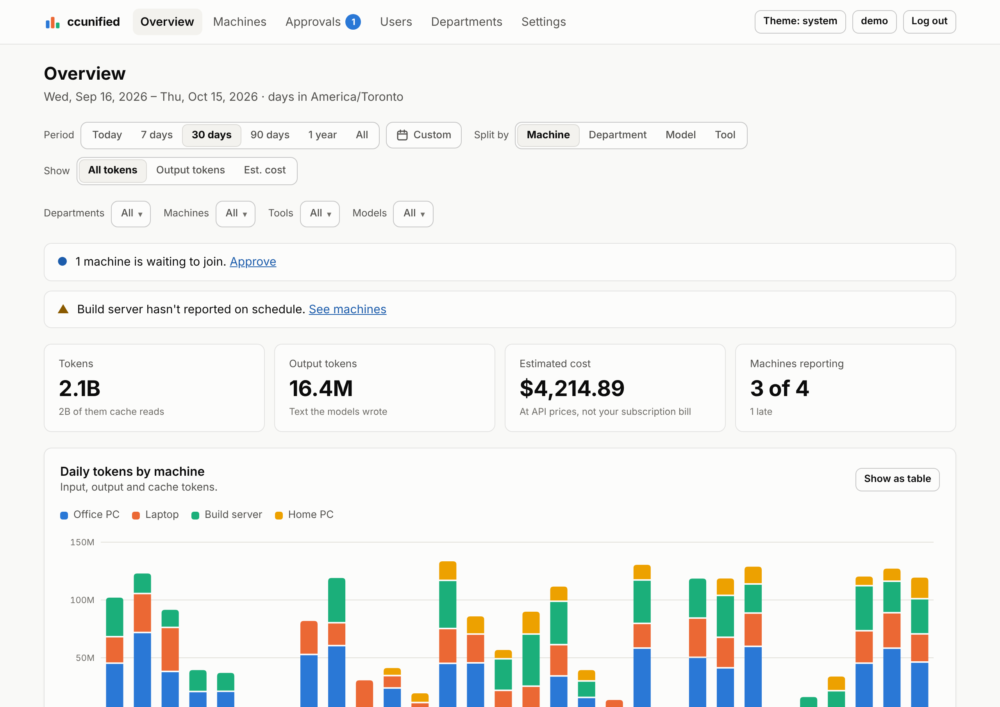
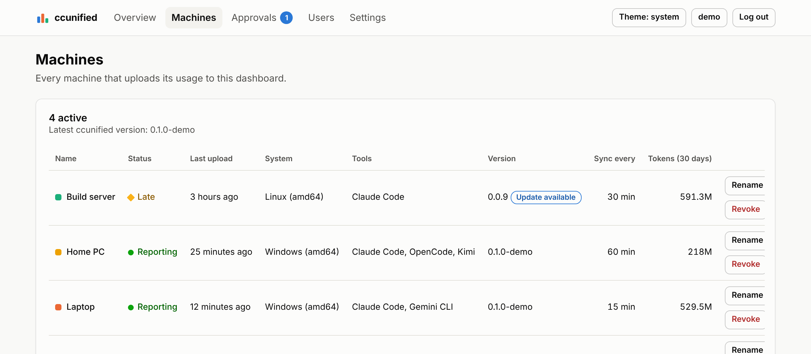

# ccunified

One dashboard for your AI coding usage across all your machines: Claude Code,
Codex, Gemini CLI, GitHub Copilot CLI, OpenCode and every other tool
[ccusage](https://github.com/ccusage/ccusage) reads.

A small program on each computer reads the tools' local usage logs (with
ccusage) and uploads daily totals to a dashboard on your own domain, hosted on
your own Cloudflare account. Your desktop, laptop and servers show up side by
side, with tokens and estimated cost per machine, per tool and per model.

<picture>
  <source media="(prefers-color-scheme: dark)" srcset="docs/images/overview-dark.png">
  
</picture>

<sub>Screenshots use demo data.</sub>

## Features

- **All machines in one place.** Windows and Linux (x86-64), each uploading in
  the background on its own schedule (every 15, 30 or 60 minutes). Linux
  servers keep uploading while you're logged out.
- **Every coding tool ccusage reads**, found automatically: Claude Code,
  Codex, Gemini CLI, GitHub Copilot CLI, OpenCode, Amp, Droid, Goose, Kilo,
  Qwen, Kimi and more. Nothing to configure.
- **Daily tokens and estimated cost** by machine, tool or model, for today, 7,
  30 or 90 days, a year, all time, or any dates you pick on a calendar, as a
  chart or a table. Filter the whole page to any machines, tools or models.
- **Yours alone.** The dashboard runs on your Cloudflare account (the free plan
  is enough) at a subdomain you choose, like `usage.example.com`. Nothing goes
  through anyone else's servers.
- **Only totals leave your machines.** Per day, tool and model: token counts
  and estimated cost. No prompts, code, file names or project names.
- **Simple to add machines.** A new machine shows a short code; you approve it
  on the dashboard.
- **Accounts with roles.** Admins and read-only viewers, with optional
  two-factor login.
- **Set up from the terminal.** One command installs the program; a wizard
  creates the dashboard on Cloudflare for you. No Node.js, Wrangler or manual
  DNS changes needed.

## What you need

- A **Cloudflare account** (free) with a **domain** on it. The domain's status
  must be Active, meaning its nameservers point to Cloudflare.
- **Windows 10 or 11**, or **Linux** on x86-64, with Claude Code or another
  supported coding tool on the machines you want to track.

## Get started

**1. On your first machine**, install ccunified. It installs into your user
account; no administrator rights are needed.

Windows (PowerShell):

```powershell
irm https://github.com/IAmForeverAloneToo/ccunified-dashboard/releases/latest/download/install.ps1 | iex
```

Linux:

```sh
curl -fsSL https://github.com/IAmForeverAloneToo/ccunified-dashboard/releases/latest/download/install.sh | sh
```

Setup starts automatically. Choose **Create a new dashboard** and follow the
prompts: you'll paste a Cloudflare API token (the wizard gives you a link with
the right permissions filled in), pick a subdomain and time zone, and create
your admin login. The full walkthrough is in **[Create your dashboard](docs/setup.md)**.

**2. On every other machine**, run the same install command, choose **Join an
existing dashboard**, and enter your dashboard's address. The machine shows a
code such as `K7QX-82MD`; approve it on the dashboard's **Approvals** page.
See **[Add machines](docs/adding-machines.md)**.

That's it. Each machine uploads its full history on joining, then keeps the
dashboard up to date in the background.

<picture>
  <source media="(prefers-color-scheme: dark)" srcset="docs/images/machines-dark.png">
  
</picture>

## Everyday commands

| Command | What it does |
|---|---|
| `ccunified status` | Shows the dashboard, the last upload and whether the background sync is set up |
| `ccunified sync` | Uploads now (the background sync does this on its own) |
| `ccunified update` | Installs the latest release |
| `ccunified uninstall` | Removes ccunified from this machine |

All commands and options are in the **[command reference](docs/commands.md)**.

## Documentation

**Using ccunified**

- [Create your dashboard](docs/setup.md): Cloudflare domain and token, and the setup wizard step by step
- [Add machines](docs/adding-machines.md): joining, approving, renaming and removing machines
- [Using the dashboard](docs/dashboard.md): the pages, users and roles, two-factor login
- [Command reference](docs/commands.md)
- [Updating](docs/commands.md#updating): the program on your machines and the dashboard on Cloudflare
- [Troubleshooting](docs/troubleshooting.md)

**How it's built**

- [Security and privacy](docs/security.md): what's uploaded, how logins and keys are protected
- [How it works](docs/how-it-works.md): components, syncing, the Worker's API and database
- [Development](docs/development.md): building, testing and the full rehearsal
- [Releasing](docs/releasing.md)

## Cost

Everything fits Cloudflare's free plan with room to spare: ten machines
syncing every 15 minutes make under 1,000 requests a day (the limit is
100,000), and a year of their data is a few megabytes of database.

The costs on the dashboard are **estimates at API prices**, as calculated by
ccusage. With a subscription (Claude, ChatGPT, Copilot, …) you aren't billed
per token, so treat them as a measure of usage, not a bill.

## License

[MIT](LICENSE). ccunified ships the [ccusage](https://github.com/ccusage/ccusage)
program (MIT); every release includes the licenses of all bundled software in
`THIRD_PARTY_NOTICES.txt`.
