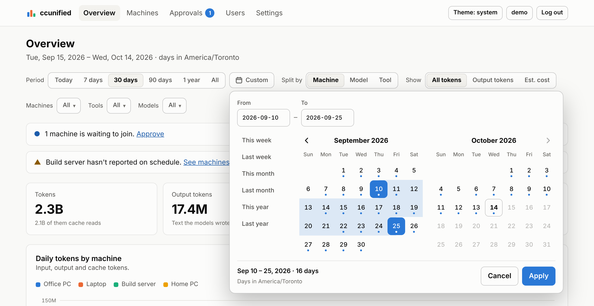
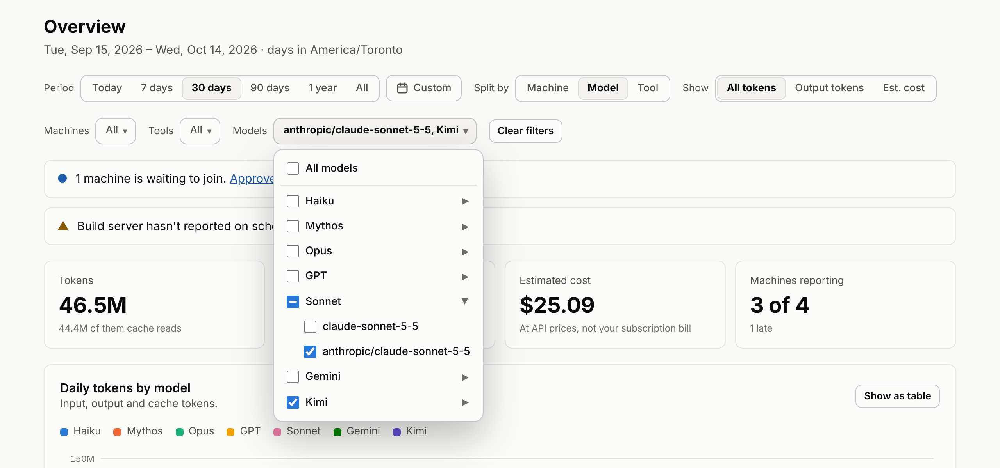
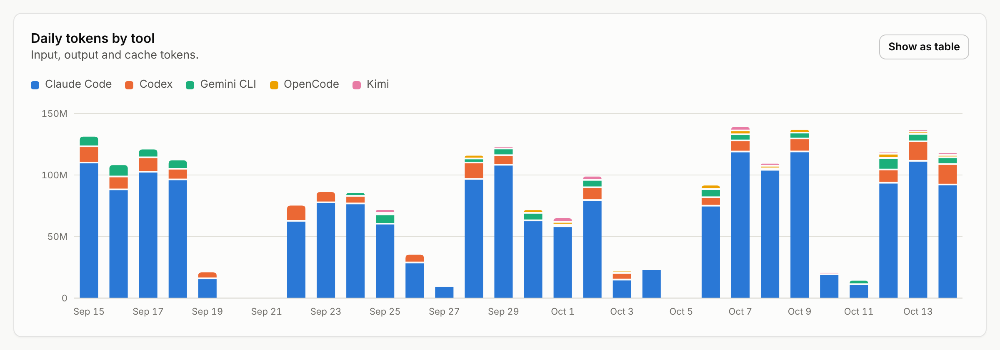

# Using the dashboard

Open your dashboard's address (for example `https://usage.example.com`) in any
browser, on a computer or a phone. It follows your system's light or dark mode;
the **Theme** button at the top switches between system, light and dark.

## Logging in

Log in with your username and password. If two-factor login is on for your
account, you're also asked for the 6-digit code from your authenticator app,
or one of your recovery codes.

A login lasts 14 days on that browser, or until you click **Log out**. After
too many wrong passwords, logging in is blocked for a while (see
[Security](security.md#logins)).

## Who can do what

| | Viewer | Admin |
|---|---|---|
| See the overview and machines | ✓ | ✓ |
| Change their own password and two-factor login | ✓ | ✓ |
| Approve, rename and revoke machines | | ✓ |
| Add and manage users | | ✓ |
| Change the dashboard's time zone | | ✓ |

The server checks these rights on every request; they're not just hidden
buttons.

## Overview

The overview answers "how much did I use my coding tools, and where":

- **Period:** today, 7, 30 or 90 days, a year, or all time (*All* starts at the
  first day with any usage), or any dates you pick with **Custom** (see below).
- **Split by:** machine, model, or tool (*Tool* appears once a second tool
  has reported usage).
- **Show:** all tokens (input, output and cache), output tokens only, or
  estimated cost.
- **Machines, Tools, Models:** limit the whole page to some of them (see
  [Filtering](#filtering-to-some-machines-tools-or-models)).
- **Totals** for the period: tokens (with how many were cache reads), output
  tokens, estimated cost, and how many machines are reporting on schedule.
- **Chart:** one column per day (per week or month for long periods), stacked
  by machine or model. Hover over or tab to a column to see its numbers;
  **Show as table** shows the same data as a table.
- **Machines, Tools and Models tables** with each one's input, output, cache
  and total tokens, estimated cost and share of the period. The Tools table
  appears once a second tool has reported usage.
- **Notices** when machines are waiting for approval or haven't reported on
  schedule.

Days begin and end in the dashboard's time zone (shown under the page title).
The page refreshes every minute while the period includes today.

### Picking your own dates

<picture>
  <source media="(prefers-color-scheme: dark)" srcset="images/date-range-dark.png">
  
</picture>

Click **Custom** next to the period buttons:

1. Click the first day, then the last; the range is highlighted as you move
   the pointer. Clicking a day twice picks just that day. You can also type
   the dates (like `2026-09-03`) in **From** and **To**, or use a shortcut:
   this or last week, month or year.
2. Click **Apply** (or press Enter in a date field). **Cancel**, Escape or
   clicking elsewhere leaves the period as it was.

- **Dots** mark the days that have any usage.
- **Days after today** (in the dashboard's time zone) can't be picked.
- A range can be up to about ten years long.
- The address includes the dates, so a custom period survives a reload, can
  be bookmarked or shared, and **Back** returns to the previous period.
- On a phone, the calendar opens as a full-width panel showing one month.
- **With the keyboard:** the arrow keys move by day and week, Page Up and Page
  Down by month (with Shift, by year), Home and End to the start and end of
  the week, and Enter picks a day.

### Filtering to some machines, tools or models

<picture>
  <source media="(prefers-color-scheme: dark)" srcset="images/filters-dark.png">
  
</picture>

**Machines**, **Tools** and **Models**, under the period, limit everything on
the page to what you tick: the totals, the chart, the tables and the date
picker's dots.

- Tick one or more; **All**, the default, turns that filter off. Filters
  combine: Tools *Kimi* with Machines *Home PC* shows Kimi's usage on Home PC.
- **Models** lists model families (Opus, GPT, Kimi, …). Ticking a family
  includes all of its models, also ones that show up later; click ▸ to pick
  exact models instead (the family then shows as partly ticked).
- **Clear filters** turns them all off.
- The address includes the filters, so they survive a reload and can be
  bookmarked or shared; **Back** undoes the changes made while a list was
  open.
- Each list appears once there's more than one thing to pick from.
- With the keyboard: Tab to a list's button and press Enter, Tab between the
  checkboxes and press Space to tick, and Escape to close.

### Tools and models

Each machine uploads the usage of every coding tool ccusage finds on it, such
as Claude Code, Codex, Gemini CLI, GitHub Copilot CLI and OpenCode.

<picture>
  <source media="(prefers-color-scheme: dark)" srcset="images/tools-dark.png">
  
</picture>

- **Colors:** each tool keeps its color: tools get colors in the order the
  dashboard first saw them. Past eight tools, the newest share a gray *Other
  tools* in the chart (the Tools table still lists each one).
- **Models** are grouped into families in the chart, whichever tool used
  them, and the Models table lists every exact model name. Claude models are
  grouped by the name after "claude" (Opus, Sonnet, Haiku, Mythos, and any
  new family), other vendors' models by their family (GPT, Gemini, Grok,
  Kimi, Qwen, GLM, DeepSeek, …), and anything else by the first word of its
  name. Like tools, families get colors in the order the dashboard first saw
  them, and only past eight families do the newest share a gray *Other
  models*. A model used through several tools (say, Claude Sonnet in Claude
  Code and in OpenCode) is one model.

Costs are **estimates at API prices**, calculated by ccusage on each machine
(OpenCode's are the costs OpenCode itself recorded). A subscription isn't
billed per token, so treat them as a measure of usage.

## Machines

Every machine that uploads to the dashboard, with its status, last upload,
operating system, the tools it has reported (once there's more than one),
ccunified version, upload interval and 30-day token total.
Admins can **Rename** and **Revoke** machines here. The *Add a machine* card
shows the install commands and your dashboard's address. Machine statuses and
removing machines are explained in [Add machines](adding-machines.md#machine-status).

## Approvals (admins)

Machines waiting to join, with the name, system and time of each request.
Type the code the machine shows to **Approve** or **Deny** it; see
[Add machines](adding-machines.md#join-a-machine).

## Users (admins)

- **Add a user:** choose a username (3–32 letters, digits, dots, dashes or
  underscores; it can't be changed later), a role, and a temporary password.
  Give them the password privately; they must choose their own when they first
  log in.
- **Make admin / Make viewer** changes their role and signs them out, so the
  change applies at once.
- **Reset password** sets a new temporary password and signs them out
  everywhere.
- **Reset two-factor** turns their two-factor login off, for when they've lost
  their authenticator and their recovery codes.
- **Disable** blocks their login and signs them out, without deleting them;
  **Enable** undoes it. **Delete** removes them for good.

You manage your own account on the *Your account* page instead. There's
always at least one active admin: the last one can't be disabled, deleted or
made a viewer.

## Your account

Click your username at the top right.

- **Password:** change it (at least 10 characters). Your other sessions are
  signed out.
- **Two-factor authentication:**
  - **Set up two-factor:** scan the QR code with an authenticator app (Google
    Authenticator, 1Password, Microsoft Authenticator, …), enter the code it
    shows, and save the 10 **recovery codes** it gives you (copy or download
    them). Each recovery code logs you in once if you lose your phone.
  - **New recovery codes** replaces the old ones.
  - **Turn off** removes two-factor from your account.

If an admin is locked out completely (forgotten password, no recovery codes),
run `ccunified server reset-password` on any of your machines; see the
[command reference](commands.md#ccunified-server-reset-password).

## Settings

- **Days (admins):** the dashboard's time zone. Changing it regroups usage into
  the new zone's days: each machine notices on its next upload and uploads its
  history again, grouped the new way. Days older than the logs still on a
  machine keep their old grouping.
- **Version:** the ccunified version the dashboard runs, whether a newer
  release exists, and when the dashboard last asked GitHub. It asks on its
  own every 6 hours; **Check for updates** asks right away. If GitHub can't
  be reached, the page says *Couldn't check for updates* and why, rather than
  that the dashboard is up to date. See [Updating](commands.md#updating).
